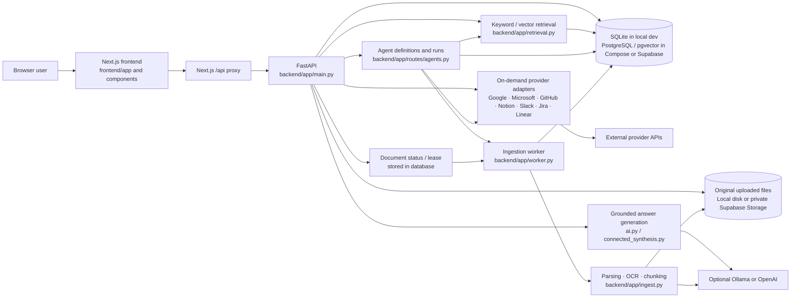
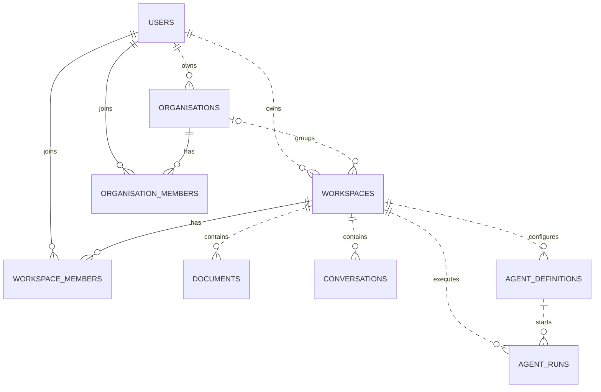
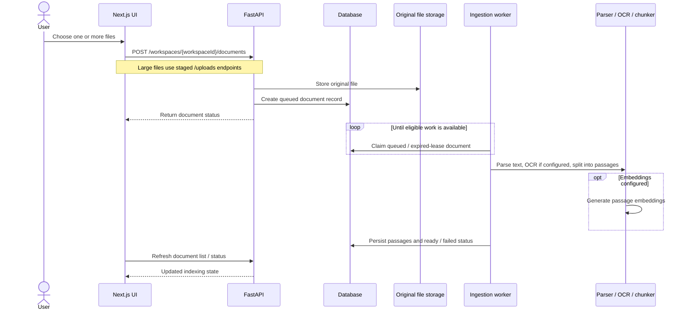
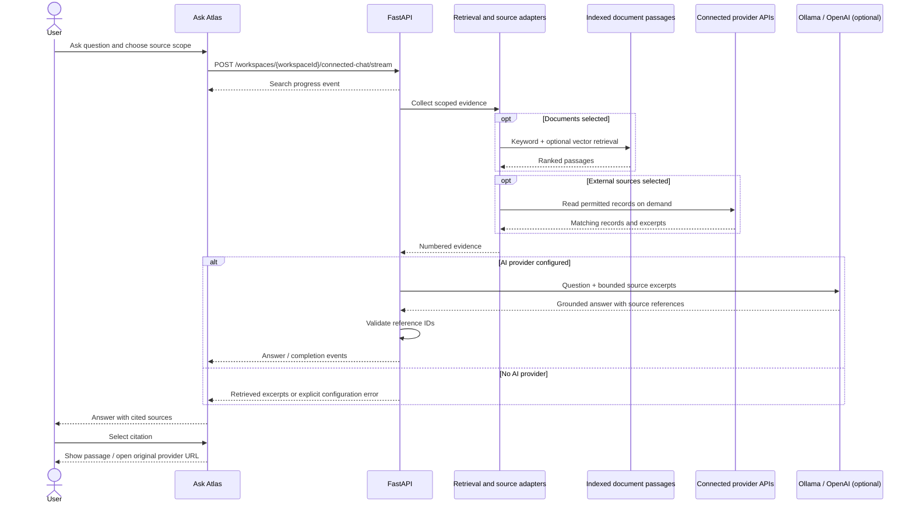
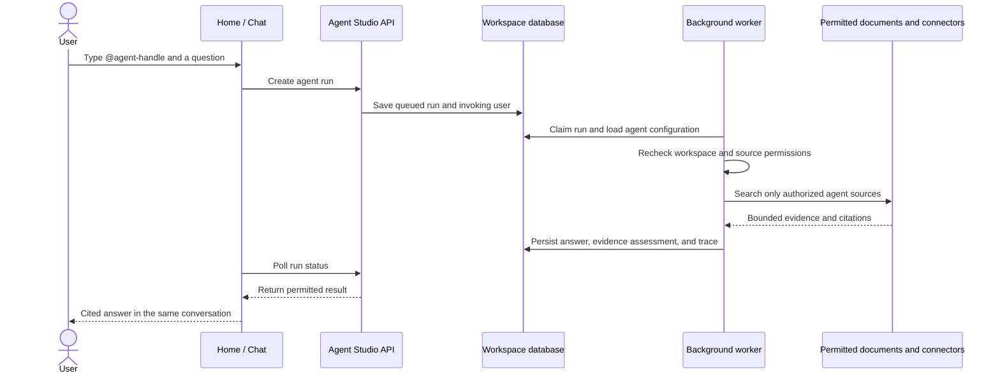

# Atlas — Multi-source AI research workspace

Atlas is a private, workspace-based AI research app. Upload documents, connect read-only data sources, ask questions with traceable citations, and create reusable research agents in **Agent Studio**. Invoke an agent from Home or Chat with an `@agent-handle`; its configured sources are independent of the chat's normal source selection, but never bypass the invoking user's access permissions.

The app uses a Next.js/TypeScript frontend and a FastAPI backend. Local development uses SQLite, Docker Compose runs PostgreSQL with pgvector, and Render can use Supabase Postgres and private Storage. You can generate answers with Ollama on your machine, OpenAI, or use source excerpts without an AI provider.

## Architecture and request flows

The diagrams below describe the code in this repository, rather than a proposed architecture. GitHub renders them directly with Mermaid.

### Interactive code walkthrough

With the frontend running locally, open the [Atlas Flow Debugger](http://localhost:3000/debugger/index.html). Choose a scenario to start at the Atlas screen and user action, then step forward or back through the real functions, and inspect example inputs, state, and outputs. Switch branches in the upload, answer, and Slack scope scenarios to see different outcomes. Open linked regression tests from the inspector, or share a step at the exact commit. The explorer reads the public Atlas repository from GitHub, pins every file to the same commit, and lets you refresh or select another ref. The displayed values are examples rather than live application state.

### System architecture



In local development the API and worker can run in the same environment; Compose runs separate API and worker services. The worker claims document records from the database rather than consuming messages from a separate queue broker. Connector records are fetched on demand, not automatically ingested into the document library.

### Data model



Organisation membership and workspace access are separate. A user accesses a workspace through ownership or an explicit workspace membership. Conversations belong to their authors within the workspace. See the [full database schema](docs/DATABASE.md) for keys, connector scopes, and audit relationships.

### Code flow: upload and index a document



The worker renews leases during processing and can retry transient failures. Search uses only documents marked ready.

### Code flow: ask a question and inspect evidence



For documents-only requests, the server may use the document answer-generation path rather than cross-source synthesis. Source IDs are checked, but a valid ID is **not proof** that every claim is supported by its citation. If the model cannot produce a valid answer, clients should show an explicit failure instead of inventing conclusions.

### Code flow: invoke a research agent



Agent runs are read-only and use the invoking user's permissions, not the agent creator's. The UI can show evidence assessments and traces; these are not guarantees of factual correctness. See [Agent Studio](docs/AGENT_STUDIO.md).

### Where to follow the code

| Workflow | Entry point | Key modules |
| --- | --- | --- |
| Frontend workspace | `frontend/app/page.tsx` | `components/AtlasWorkspace.tsx`, `components/chat/`, `components/documents/` |
| Upload and background indexing | `backend/app/routes/documents.py` | `worker.py`, `ingest.py`, `db.py` |
| Document retrieval | `backend/app/routes/chat.py` | `retrieval.py`, `ai.py` |
| Cross-source answers | `backend/app/routes/chat.py` | `connectors/external_sources.py`, `connectors/github/`, `connectors/gmail.py`, `connectors/drive.py`, `connected_synthesis.py` |
| Citation display | `frontend/components/chat/ResearchAnswer.tsx` | `frontend/lib/evidence.ts` |
| Agent creation, runs and authorization | `backend/app/routes/agents.py` | `agents/`, `rbac.py` |
| Agent library and `@` mentions | `frontend/components/agents/AgentStudioPanel.tsx` | `components/agents/useAgentResearch.ts`, `components/chat/ResearchComposer.tsx`, `components/home/HomeView.tsx` |


GitHub code-search questions can also ask Atlas to **trace a code flow** (for example, “trace the document upload flow”). Atlas performs a bounded first-pass code search, extracts up to three function/class symbols from returned snippets, and searches for references to those symbols. Results are labeled by a conservative path-based layer hint such as Frontend / UI, API / routing, Backend / service, or Database / persistence. This is a discovery aid, not a complete call graph: GitHub search indexing, snippets, dynamic dispatch, generated code, and cross-repository boundaries can leave gaps. Open the linked files and verify each hop before treating the trace as complete.

## Get started locally

### Requirements

- macOS or Linux (the staged-upload implementation uses filesystem locks)
- Python 3.9 or later
- Node.js 20.9 or later and npm
- Tesseract OCR for scanned PDFs (optional; Docker installs it for you)
- Ollama for local AI (optional), or an OpenAI API key

### Install and start

Run these commands from the repository root:

```sh
cp .env.example .env
python3 -m venv .venv
.venv/bin/pip install -r backend/requirements-dev.txt
```

Generate an encryption key for connected-source credentials:

```sh
.venv/bin/python -c "from cryptography.fernet import Fernet; print(Fernet.generate_key().decode())"
```

Copy the printed value into `.env` as `GMAIL_TOKEN_ENCRYPTION_KEY=...`. This key is required for encrypted connected-source credentials. Keep it private and back it up: Atlas cannot decrypt saved credentials if the key is lost or changed.

Start the API in one terminal:

```sh
PYTHONPATH=backend .venv/bin/uvicorn app.main:app --host 127.0.0.1 --port 8000
```

Start the frontend in a second terminal:

```sh
cd frontend
npm ci
npm run dev
```

Open <http://localhost:3000>, create a local development account, and use the default workspace or create another. The API docs are at <http://127.0.0.1:8000/docs>. For verified email signup, password reset, or Google sign-in, configure [Supabase Auth](docs/OPERATIONS.md#verified-sign-in-with-supabase-auth).

For scanned PDFs, install Tesseract locally (`brew install tesseract` on macOS or `sudo apt-get install tesseract-ocr` on Debian/Ubuntu). To turn OCR off and accept searchable PDFs only, set `OCR_ENABLED=false` in `.env`.

To try document search, upload a document you have permission to use and ask a question about its contents.

SQLite data and uploaded files are stored under `data/` by default. The directory is excluded from Git. Back it up if you need to preserve a local workspace.

## Choose how Atlas generates answers

The `.env.example` file defaults to `AI_PROVIDER=openai` with an empty API key. In that configuration, Atlas still searches sources and shows matching excerpts, but does not synthesize answers.

### Local AI with Ollama

1. Install [Ollama](https://ollama.com/download).
2. Download the chat and embedding models:

   ```sh
   ollama pull qwen3:4b
   ollama pull nomic-embed-text
   ```

3. Set these values in `.env`:

   ```dotenv
   AI_PROVIDER=ollama
   OLLAMA_URL=http://127.0.0.1:11434
   OLLAMA_CHAT_MODEL=qwen3:4b
   OLLAMA_EMBED_MODEL=nomic-embed-text
   ```

4. Restart the API.

Ollama keeps prompts and generated answers on the machine running Ollama. Atlas does not set an output-token cap for local generation; response time depends on your hardware, and the model still has a finite context window. New uploads use local embeddings. To re-embed existing documents, stop the API worker and run from the repository root:

```sh
PYTHONPATH=backend .venv/bin/python ops/reindex_local.py
```

### OpenAI

Set `AI_PROVIDER=openai` and `OPENAI_API_KEY` in `.env`, then restart the API. Optionally set `CHAT_MODEL` and `EMBED_MODEL`; the defaults are `gpt-4.1-mini` and `text-embedding-3-small`.

With OpenAI selected, document passages and selected connected-source excerpts are sent to the configured OpenAI API for embeddings or answer generation. Responses use `store=False`; that does not promise zero provider-side retention. Only send content you are authorized to process with that provider.

### Search without generated answers

Set `AI_PROVIDER=none` and leave `OPENAI_API_KEY` empty. Atlas returns matching source excerpts instead of a synthesized answer.

## Create and use research agents

1. Open **Agents** in your workspace and choose **Create agent**.
2. Give it a name and instructions, choose an output format, and select its research sources: ready workspace documents, Gmail, and/or available connected providers.
3. Save the agent. Its library card shows its source scope and generated handle (for example `@research-analyst`); you can copy the handle.
4. In **Home** or **Chat**, type `@` to select the agent, then enter your question. The answer and citations appear in that conversation. Use Agent Studio for configuration and historical run inspection, not a separate chat.
5. Keep the background worker running to process queued research.

Agent source settings **override chat source filters for that agent invocation**, but access is always evaluated for the person asking. An agent configured with a source you cannot access does not grant you that source. Previously saved agent evidence may be hidden if access is revoked. Research uses bounded retrieval and automated claim assessments; validate important conclusions against the cited evidence.

See [Agent Studio documentation](docs/AGENT_STUDIO.md) for lifecycle, permissions, APIs and limitations.

## Connect data sources

See the [Source setup guide](docs/SOURCE_SETUP.md) for credentials, OAuth callbacks, and search limits for all providers.

Open **Sources** to connect a provider, then select it above the prompt in **Ask Atlas**. Connections are workspace-scoped and Atlas reads source content on demand.

## Run with Docker Compose

Docker Compose runs PostgreSQL/pgvector, the API, a separate background worker, and the frontend. From the repository root:

```sh
cp .env.example .env
```

Set `POSTGRES_PASSWORD` to a strong value in `.env`. Set `GMAIL_TOKEN_ENCRYPTION_KEY` if you will connect sources. Add an AI provider configuration if you want generated answers, and add the Google OAuth values if using Gmail or Drive. Then run:

```sh
docker compose up --build
```

Open <http://localhost:3000>. The database and documents use named volumes. The web port is bound to loopback. Compose runs Ollama on the host by default only if you configure:

```dotenv
AI_PROVIDER=ollama
OLLAMA_URL=http://host.docker.internal:11434
```

Pull the models on the host before connecting. `host.docker.internal` lets the API container reach Ollama on macOS/Windows; on Linux, configure a host-gateway route or use another reachable Ollama URL.

The default Compose PostgreSQL password is for local development only. Changing `POSTGRES_PASSWORD` after PostgreSQL has initialized does not change the existing database user's password; recreate or update the database credentials deliberately. Do not expose this development stack directly to the public internet.

## Deploy on Render

The Render Dockerfile is at `ops/render/Dockerfile`. See [Supabase on Render](docs/OPERATIONS.md#supabase-on-render) to persist database records and original files across redeploys. Configure [verified sign-in](docs/OPERATIONS.md#verified-sign-in-with-supabase-auth) before deploying with `COOKIE_SECURE=true`.

### Recovering an Alembic revision mismatch on Render

If startup fails with `Can't locate revision identified by '0011'` (or another revision), the **database migration record** and the **migration files in the deployed image** disagree. The image currently contains revisions `0001` through `0010`. Rebuilding the image alone does not clear a persistent SQLite disk or external PostgreSQL database.

1. Confirm the Render service's `DATABASE_URL` and `DATA_DIR` configuration, and make a verified backup of the selected database and uploaded originals. Do not delete a live disk or shared Supabase/Render database as a troubleshooting shortcut.
2. For PostgreSQL, inspect the version with `SELECT version_num FROM alembic_version;`. For SQLite, open the configured database using `sqlite3 <database-file> 'SELECT version_num FROM alembic_version;'`. Also inspect the migration files in the exact deployed commit.
3. If the database has already applied a revision absent from the image, restore that original migration and any subsequent chain from source control or a known-good deployment. Review its schema operations before running `alembic upgrade head`.
4. For an **intentionally disposable** environment only, provision a brand-new empty database (and separate original-file storage, if intentionally discarded), update the service's `DATABASE_URL` and relevant storage settings, then redeploy. This discards its users, documents, conversations, connections and migration history. Create a fresh database rather than altering `alembic_version` on an unknown schema.

Never use `alembic stamp head` to suppress an unknown revision error: it changes the revision marker without applying or verifying schema changes. Atlas applies migrations in `backend/app/db.py:init_db` during FastAPI startup.

## Troubleshooting

- **Atlas only shows excerpts, not an answer:** Check `AI_PROVIDER`, the API logs, and that Ollama is running or the OpenAI key is valid. Restart the API after changing `.env`.
- **Ollama is unreachable in Docker:** `127.0.0.1` inside a container refers to that container. Use `http://host.docker.internal:11434` on macOS/Windows or a host-reachable address on Linux.
- **A saved connection cannot be decrypted:** `GMAIL_TOKEN_ENCRYPTION_KEY` changed or is missing. Restore the original key; otherwise reconnect each provider. Back up the key with the database.
- **Google sign-in returns a redirect error:** Google Cloud must allow Supabase’s `/auth/v1/callback`, and Supabase must allow Atlas’s `/api/auth/google/callback`.
- **A Gmail, Drive, or Calendar connection returns a redirect error:** Register the corresponding Atlas connector callback directly in Google Cloud. See the [connector callback table](docs/SOURCE_SETUP.md#oauth-callbacks).
- **Signup or password-reset email never arrives:** Verify the Supabase email templates and sender configuration. The built-in sender is limited to project team addresses. For other users, configure custom SMTP in Supabase.
- **Google OAuth says access is blocked:** In OAuth consent-screen testing mode, add the account as a test user. Check that the required Gmail or Drive API is enabled and review verification status.
- **Slack says token type is not allowed:** Reconnect with the User OAuth Token after adding `search:read` and reinstalling the app.
- **Notion search returns no pages:** Confirm Atlas was shared with the page or a parent page. The token alone cannot see unshared content.
- **Scanned PDF has no text:** Install Tesseract OCR. Set `OCR_ENABLED=false` only when you want to require searchable PDFs.
- **A model change produces poor document search:** Re-embed existing documents after changing embedding providers or models.

## Development and validation

Run backend tests and frontend checks from the repository root:

```sh
PYTHONPATH=backend .venv/bin/pytest backend/tests -q
cd frontend
npm run typecheck
npm run build
```

The tests use an isolated temporary database and mock provider calls. They do not verify OAuth credentials or live access to Gmail, Drive, GitHub, Notion, or Slack.

Install the development requirements before running style checks. From the repository root,
`make format` applies Ruff import sorting/formatting and Prettier; `make format-check`
checks Python lint/formatting and frontend formatting without changing files.

For browser tests, install Playwright and Chromium:

```sh
cd frontend
npm install --no-save @playwright/test@1.56.1
npx playwright install chromium
npx playwright test
```

Run the offline keyword retrieval regression with:

```sh
PYTHONPATH=backend .venv/bin/python evals/retrieval_eval.py evals/retrieval_cases.json --k 5
```

The fixture uses synthetic queries and labeled passages. It measures keyword ranking and serves as a regression check.

## What Atlas supports

- Workspace accounts, private documents, saved conversations, and source citations. Supabase Auth adds verified email signup, password reset, and Google sign-in.
- PDF, DOCX, TXT, Markdown, CSV, JSON, and HTML ingestion. Individual files can be up to 250 MB; scanned PDF text extraction uses Tesseract OCR.
- Durable document processing with retry and reindex controls.
- Keyword search, optional vector search, and source-grounded answers.
- [On-demand retrieval from connected sources](docs/SOURCE_SETUP.md), including Google Workspace, Microsoft 365, and engineering tools.
- [Agent Studio](docs/AGENT_STUDIO.md): configurable read-only research agents, source-specific permissions, `@` mentions, evidence assessments, and persisted run traces.

Connected sources use permission checks at the provider and do not sync in the background. AI answers can miss details; review cited passages before relying on them. Atlas validates citation references but does not prove every claim is supported by its citation.

## Security and deployment notes

This project is a development release, not a hardened public service. Before serving other users, add HTTPS and set `COOKIE_SECURE=true`, configure a protected secret store, restrict database/network access, validate backup and restore, and implement rate limits, audit logging, and document parsing isolation. Review provider verification and privacy requirements for the scopes you enable. Do not deploy the sample Compose password or expose the development stack publicly.

Tokens and originals are workspace data. Protect the database, document volume, `.env`, and encryption-key backup as one set. Revoking a token at the provider is separate from disconnecting it in Atlas.

## Project layout

- `backend/app/main.py`: application setup, router registration, and request middleware.
- `backend/app/routes/chat.py`: document and connected chat, including streaming.
- `backend/app/ingest.py`: file parsing, OCR, and chunking.
- `backend/app/retrieval.py`: keyword/vector retrieval and ranking.
- `backend/app/ai.py`: embeddings and grounded answer generation.
- `backend/app/connectors/external_sources.py`: Connected-source routes, credentials, and search dispatch.
- `backend/app/connectors/github/`: GitHub query parsing, code flow tracing, and repository evidence retrieval.
- `backend/app/connectors/drive.py` and `backend/app/connectors/gmail.py`: Google connectors.
- `backend/app/worker.py`: background document ingestion and agent research execution.
- `backend/app/routes/agents.py`: agent definition and run endpoints.
- `backend/app/agents/`: agent models, source authorization, execution, evidence graph and claim assessment.
- `frontend/app/page.tsx`: lightweight Next.js entry point.
- `frontend/components/AtlasWorkspace.tsx`: workspace state and screen composition.
- `frontend/components/{home,documents,chat,agents,sources,auth,layout,ui}/`: feature-level UI and shared components.
- `frontend/hooks/`: theme, conversation, Gmail and connected-source state.
- `frontend/utils/`: typed session, document, and conversation actions.
- `frontend/app/{globals,rebuild}.css`: ordered entry points for styles in `frontend/app/styles/`; rule order is preserved for existing visual refinements.
- `compose.yaml`: PostgreSQL, API, worker, and web services.

## Organisations and access roles

Open your avatar to visit **Account & settings** (`/settings`). Use **Workspace settings**
for membership, source permissions, ownership, security history, and deletion; use
**Organisations** to manage teams and create organisation workspaces. The workspace
switcher stays focused on switching and creating personal workspaces.
Create an organisation, add existing registered Atlas accounts by email, and create
organisation workspaces from the Organisations section. Add members to each workspace explicitly;
organisation membership alone does not grant access to its content. Personal
workspaces can also grant access directly to registered accounts.

| Scope | Role | Permissions |
| --- | --- | --- |
| Organisation | Owner | Manage organisation membership; remains the protected owner |
| Organisation | Admin | Manage organisation members and create organisation workspaces |
| Organisation | Member | Belong to the organisation; needs a separate workspace grant |
| Workspace | Manager | Read and ask, manage documents and workspace members, create connections, delete workspace |
| Workspace | Editor | Read and ask, upload/import, reindex, and delete documents |
| Workspace | Viewer | Read documents, download originals, search permitted sources, and ask questions |

Workspace creators remain protected managers. Adding or changing membership uses
**Add or update member** with the registered account's exact email and desired role.
Atlas does not send invitation emails. Organisation deletion, SSO, groups, and
custom roles are not implemented. Owners can use **Transfer ownership** to choose an
existing member and confirm by typing the workspace or organisation name. The previous
workspace owner remains a manager; the previous organisation owner remains an admin.
Transfer a departing member's workspaces before removing them from the organisation.
Documents are preserved; private chats and personal credentials keep their owners.

**Privacy boundaries:** saved conversations belong to their author, including in
shared workspaces. Organisation administrators do not automatically gain workspace
content access. Connector credentials are private to the connecting user by default.
Only their owner, while a workspace manager, can explicitly share, replace, or
remove a connection. Source permissions support private, selected-member, and
all-workspace access. Grant selected members in **Source permissions**, or use the
workspace-wide checkbox to include every current and future member. Managers and
organisation admins cannot bypass source grants. Provider permissions still bound
what the shared credential can retrieve. For Google Drive and Slack, save a list
of file IDs or channel IDs before sharing. The allowlist applies to all recipients
of that connection. Drive folders and shortcuts, Slack direct and group messages,
and results Atlas cannot verify are excluded. Other connectors retain
connection-level sharing. One credential slot per provider/workspace is supported.

Migration `0010` pauses existing Drive and Slack shares and clears their selected
member grants. Connection owners can restore sharing by saving a resource list
and choosing the recipients again. Owners retain access through their own credentials.

Removing a member revokes their workspace access, removes their source grants, and
disconnects their saved credentials so an offboarded account cannot occupy a provider slot.
Revoke provider-side authorisation separately when appropriate.
Unsharing blocks future retrieval, but does not erase excerpts already saved in
other members' private chats. API permissions are checked on the server, including
legacy connector routes and OAuth callbacks; slow chat results recheck access before
releasing answer text.

**Security history** lists membership, ownership, connection creation/removal, and
source-sharing changes. Managers can read workspace history; organisation owners and
admins can read organisation-wide access metadata (including workspace events),
without receiving workspace content access. Ownership, membership, source-grant and
credential changes serialize on their parent resource to avoid conflicting updates.
Events are committed atomically with
successful access changes, are paginated, and cannot be modified or deleted through
the API. No credentials, prompts, or source excerpts are recorded. Events start at
this upgrade; older changes are not reconstructed.

Every scoped route declares its required role through `workspace_permission` or
`organisation_permission`; role selection does not depend on URL matching. The route
coverage regression test catches newly added workspace routes missing a declaration.

Migrations `0007` and `0008` run at startup. Migration `0008` adds source grants and
security history without broadening existing sharing or rewriting credentials.
Migration `0007` preserves existing workspaces as personal,
assigns existing chats and connections to their workspace owner, and keeps all
connections private. Back up the database before upgrading. Downgrade is deliberately
blocked because dropping access metadata could expose shared workspace data; restore
a pre-upgrade backup if a rollback is required.


## Security and production readiness

See [SECURITY.md](SECURITY.md) for implemented safeguards and the explicit
production-hardening checklist. Local unit tests do not verify real provider OAuth
configuration or deployed infrastructure. Do not expose a production deployment
until staging, secrets, network, backup, monitoring, and independent-review gates
have been completed.

Citation auditing checks reference validity, lexical overlap, numbers, and common
negation patterns. It deliberately reports semantic entailment as **not evaluated**;
every claim requires human review. The offline retrieval benchmark is synthetic
and should be treated as a regression fixture, not a production-quality score.
