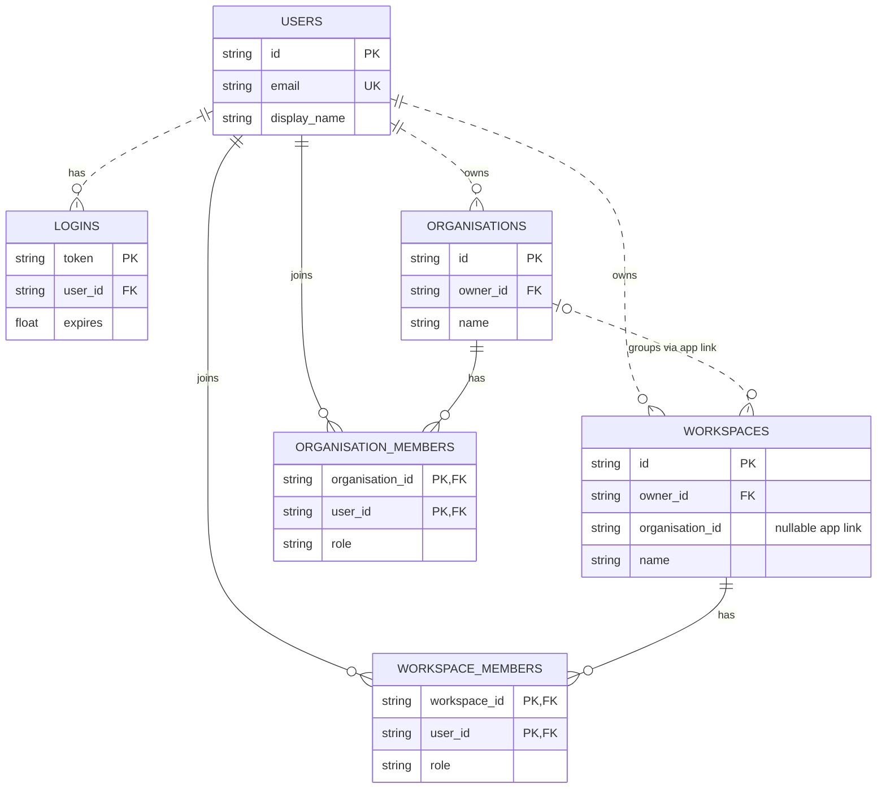
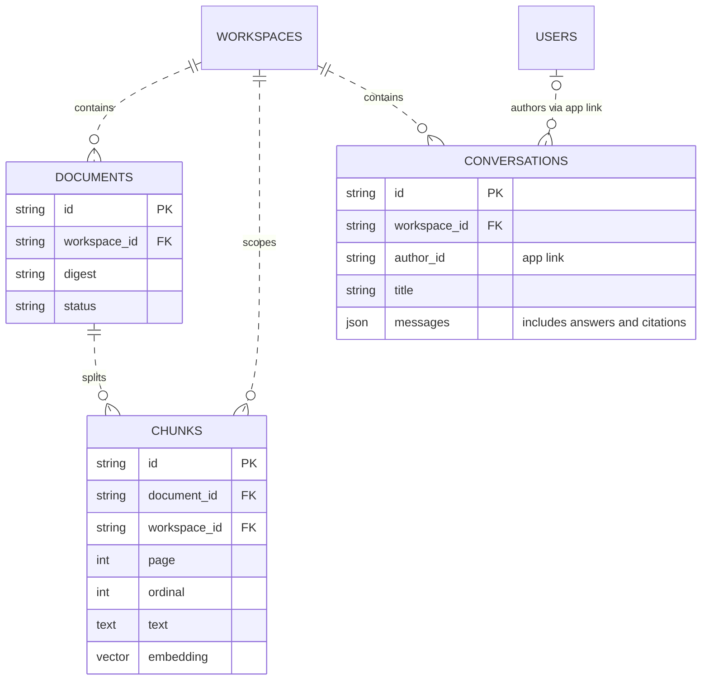
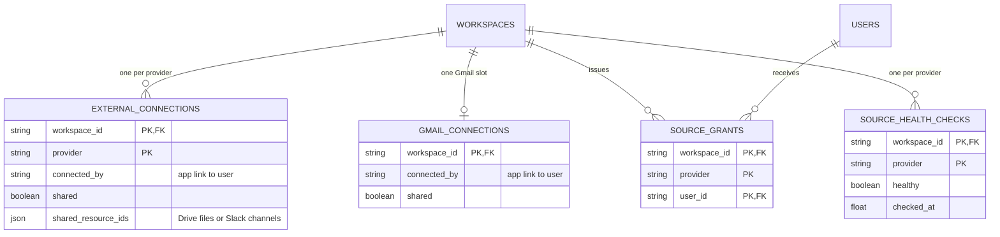
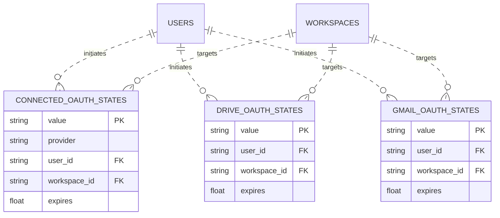
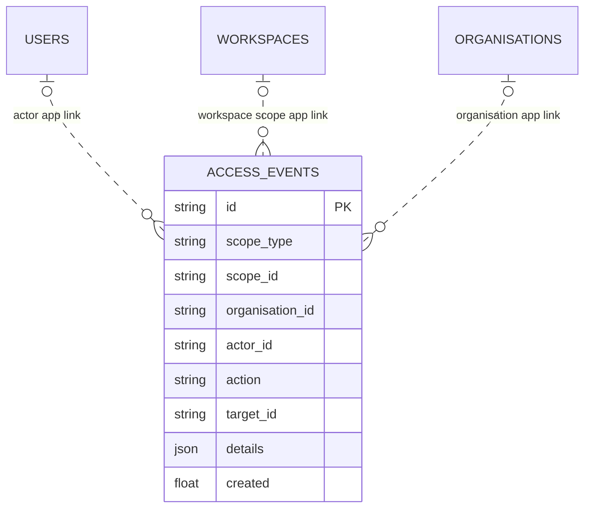

# Atlas database design

Atlas uses SQLite for local development and PostgreSQL with pgvector for deployments. The diagrams cover the 17 application tables. **FK** identifies a database foreign key. **App link** identifies a stored reference resolved by Atlas. Mermaid solid and dotted lines denote identifying and non-identifying relationships, respectively.

[SQLAlchemy models](../backend/app/db.py) · [Alembic migrations](../backend/migrations/versions)

## Accounts and access

A workspace with no organisation ID is personal. Organisation membership roles are `admin` and `member`. Workspace membership roles are `manager`, `editor`, and `viewer`. Ownership is stored separately. Organisation membership alone grants no workspace content access.

## Research and conversations

Documents are unique by `(workspace_id, digest)`. A chunk has separate foreign keys to its document and workspace. Atlas keeps those references consistent when indexing. Conversation history is private to its author. Messages and citations are stored in `conversations.messages`.

SQLite can also maintain `chunks_fts`, an FTS5 virtual table synchronized with `chunks` by triggers. Alembic tracks the migration revision in `alembic_version`.

## Connected sources

Atlas resolves grants and health checks by `(workspace_id, provider)`. Gmail uses `gmail_connections` and other providers use `external_connections`. A connection can be private, shared with selected members through `source_grants`, or shared with the workspace through its `shared` flag. Shared Drive and Slack searches are additionally restricted by the connection's resource allowlist.

## OAuth state and audit history

OAuth state rows bind pending authorization attempts to a user and workspace. The connected OAuth table also stores the provider and a PKCE verifier.

The pair `(scope_type, scope_id)` identifies a workspace or organisation. The separate `organisation_id` supports organisation-wide audit queries for workspace events. Audit references use stored IDs so events can survive deletion of the records they describe.
