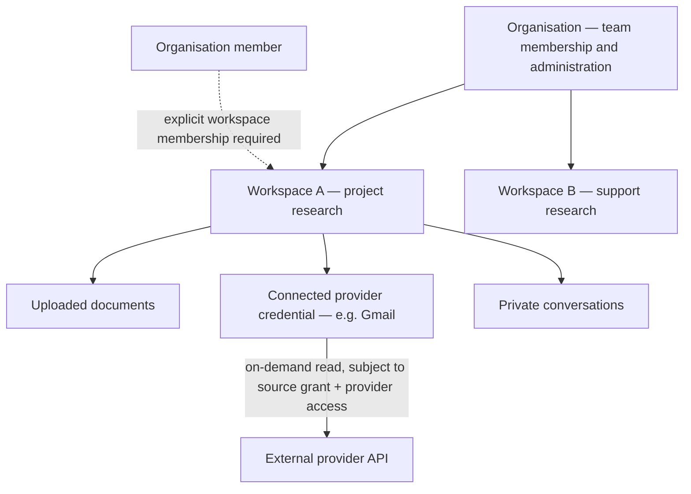
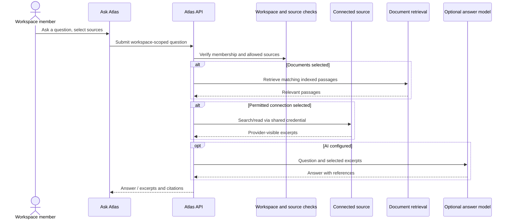

# Organisations, workspaces and source access

Atlas separates **who belongs to a team**, **who may enter a workspace**, and **which connected accounts may be queried**. Those are three different permissions.

## Quick mental model

- **Organisation:** a membership and administration boundary for a team. An organisation does not hold a shared inbox or automatically expose the documents in its workspaces.
- **Workspace:** a collection of documents, conversations and provider connections used to research a topic or project. It can be personal or attached to an organisation.
- **Member:** an existing registered Atlas account. Membership of an organisation does **not** automatically make the account a member of its workspaces.
- **Source connection:** a single credential slot for a provider **within one workspace** (for example, one Gmail account connected to a workspace). The connecting account owns that credential; access to use it is granted separately.
- **Conversation:** a private record owned by the person who started it, even inside a shared workspace.

A personal workspace exists independently of any organisation. An organisation admin can manage team membership without necessarily seeing workspace documents, source results or conversations.

## Roles and what they do

| Level | Role | Can do |
| --- | --- | --- |
| Organisation | Owner | Manage membership and protected organisation ownership |
| Organisation | Admin | Manage organisation members and create organisation workspaces |
| Organisation | Member | Belong to the organisation; access to each workspace still requires an explicit grant |
| Workspace | Manager | Read and ask questions; manage documents, memberships and source connections; delete workspace |
| Workspace | Editor | Read and ask questions; upload, import, reindex and delete documents |
| Workspace | Viewer | Read and download accessible documents and ask questions using sources they are permitted to use |

**Why is there an Editor role in a read-only connector product?** “Read-only” describes Atlas's relationship to *external providers*: it does not change emails, Drive files or other provider data. An Editor can still change **Atlas's own document library** by importing, reindexing or deleting documents. An Editor cannot administer members or connection sharing.

Workspace creators remain protected Managers. The organisation and workspace roles are independent: a person may be an organisation Admin but only a Viewer in one workspace (or have no access to it at all).

## How connected data moves

1. A Manager or Editor uploads a document. Atlas stores the original and indexes extracted passages in that workspace; the background worker handles indexing.
2. A workspace Manager connects a provider account to the workspace's single slot for that provider.
3. The credential is private to its connecting owner unless that owner, while a Manager, explicitly shares it with selected workspace members or everyone in the workspace.
4. A person asks Atlas a question and selects the sources to search. The server verifies their workspace membership and the source grants before reading connected data.
5. Atlas fetches provider records **on demand**. External data is **not automatically copied into the document library**. The answer may cite document passages and/or fetched source excerpts.
6. Saved conversations are private to their author. Source excerpts already included in a saved private conversation are not erased retroactively when a grant is revoked.

A shared credential never expands the underlying provider account's permissions. Atlas source grants are not a replacement for item-by-item ACL checks from the original provider.

## Example: one team, two projects

Imagine an organisation named **Acme** with **Research** and **Operations** workspaces:

- The organisation Owner adds a colleague to Acme. They cannot open Research or Operations yet.
- A Research Manager adds that colleague as a Viewer in Research only. Operations stays inaccessible.
- The Manager connects a Gmail account to Research and shares it only with the colleague. Other Research members cannot search that Gmail connection.
- The colleague can ask questions over accessible Research documents and the permitted Gmail source, but cannot upload/delete documents or manage that connection.
- Their saved chat is private to them; the Manager cannot open it merely because they manage Research.

## Common questions

**Does one Gmail account connect to an entire organisation?** No. Connections live in workspaces. There is one credential slot per provider per workspace, with ownership and explicit grants within that workspace.

**Can a workspace use two Gmail accounts at once?** Not through two distinct Gmail slots in the same workspace today. A second Gmail connection would need a different workspace, or a future multi-account feature.

**Can the organisation Owner see every workspace?** No. Organisation membership and administration do not override workspace access checks or source grants.

**Can a Viewer ask questions?** Yes, using workspace documents and connected sources for which they have permission.

**Are provider records synced into Atlas?** No automatic background sync. Atlas searches connected sources when selected for a question; uploaded documents are stored and indexed separately.

**Does disconnecting revoke provider access?** It removes Atlas's saved credential. Revoke the authorisation at the provider too when needed.

**Are there invitations and enterprise identity management?** Accounts must already exist to be added by email. Invitation emails, SSO, group-based access and custom roles are not currently supported.

## Where to manage these settings

- **Avatar → Account & settings:** profile/account settings.
- **Organisations:** organisation members and organisation workspaces.
- **Workspace settings:** workspace membership, ownership, source permissions, security history and deletion.
- **Sources:** connect sources and see provider configuration.
- **Ask Atlas:** select permitted sources above the question input.

For implementation details, system diagrams, initial setup and deployment cautions, see the [project README](../README.md). This guide describes the current permissions model, not a design proposal.
